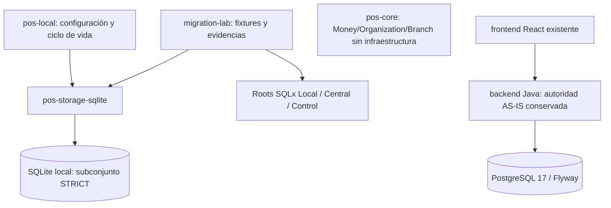

# Foundation Rust — HiQNet POS

**Estado: PARCIAL. Solo desarrollo y datos sintéticos. No sustituye Java.**

Esta foundation materializa el comienzo de F4–21, no Free Local completo. El
laboratorio integrado ejecuta **41 comprobaciones técnicas reales** (SQLite,
PostgreSQL 17 nativo, auth sintético y origen Flyway V1–V25) y conserva **1/30
casos normativos aprobados** (PAR-08, exportador determinista) y 29 bloqueados.
`--require-complete` bloquea merge con salida `2`.

El bloqueo normativo es material: F1–10 contiene 82 fichas tabulares (no 83),
cinco dependencias sin ficha física y una incompatibilidad de `unit_cost` entre
Java (NULL en ORDERED/RECEIVED) y el destino congelado (NOT NULL). Ver
[ADR-0021](../docs/01-architecture/adr/0021-frozen-physical-parity-conflicts.md).
El incremento 0c aporta [reconciliación Git/CI](../docs/05-development/rust-increment-0c-git.md),
[cinco fichas propuestas](../docs/05-development/rust-missing-physical-proposal.md),
[mapping de compras](../docs/05-development/rust-purchase-parity-contract.md) y
[CC-0021 sin aprobar](../docs/05-development/rust-adr0021-change-control.md).
No se implementa DDL de esos candidatos antes de su aceptación. El
[informe 0c](../docs/05-development/rust-increment-0c-report.md) reúne los 30
estados normativos, comandos, digests y decisiones pendientes.

## Arquitectura materializada



```text
backend-rust/
  Cargo.toml / Cargo.lock / rust-toolchain.toml
  crates/pos-core/             # Sin dependencias externas ni SQLx
  crates/pos-storage-sqlite/   # Open, migración Local embebida, checkpoint
  apps/pos-local/              # Proceso de prueba, sin HTTP, IPC, auth ni UI
  migrations/local/           # 0001: organization / branch (parcial)
  migrations/central/         # 0001: operational_tenant (ejecutado, parcial)
  migrations/control/         # 0001: customer (ejecutado, parcial)
  tools/migration-lab/         # Runner, fixtures, PostgreSQL nativo, origen Java,
                               # auth sintético, tests e informes
```

No se crean crates vacíos para sync, HTTP, entitlements o PostgreSQL. El núcleo
no depende del adaptador; tampoco se introduce un puerto de repositorio sin un
caso de uso que lo necesite. El binario compone infraestructura explícitamente.
Tauri/IPC sigue siendo el transporte preferido por F4–21; **no se abre ningún
socket HTTP local** y no se declara compatibilidad Rust con `/api/v1`.

## Requisitos y comandos reproducibles

Rust **1.99.1** fijado, edición 2024; MSRV declarada **1.99**. La validación de
esta entrega usa 1.99.1 en Windows y Linux/CI; PostgreSQL nativo del Migration
Lab requiere Unix/Linux o WSL2 por sus sockets Unix y permisos POSIX, y no se
emula en Windows.
La primera resolución requiere red para crates.io; la instalación del toolchain
requiere los servidores de Rust. `Cargo.lock` fija el grafo; no eliminarlo.

El laboratorio PostgreSQL compila **PostgreSQL 17.11** desde fuente oficial con
SHA-256 fijado, sin Docker, `sudo`, servicios del sistema ni URL externa. El
origen Java usa el Maven wrapper existente y las migraciones V1–V25 intactas.

Desde este directorio:

```sh
cargo fetch --locked
python3 -B tools/migration-lab/scripts/test_verify_evidence.py
cargo fmt --all -- --check
cargo clippy --locked --workspace --all-targets --all-features -- -D warnings
cargo test --locked --workspace --all-features
cargo build --locked --workspace --all-features

# Construye PG 17.11 en target/pg17-build/install/bin (idempotente, con lock).
sh tools/migration-lab/scripts/build_postgres.sh

cargo run --locked -p migration-lab -- \
  --output target/migration-evidence \
  --postgres-bin target/pg17-build/install/bin --java-source
python3 tools/migration-lab/scripts/verify_evidence.py \
  --evidence target/migration-evidence --expect-exit 0

# Gate obligatorio: exit 2 mientras falte cualquiera de los 30 casos normativos.
cargo run --locked -p migration-lab -- \
  --output target/migration-gate-evidence \
  --postgres-bin target/pg17-build/install/bin --java-source --require-complete
python3 tools/migration-lab/scripts/verify_evidence.py \
  --evidence target/migration-gate-evidence --expect-exit 2
```

Cada salida del lab debe ser un **directorio nuevo con padre existente**. No se
sobrescriben evidencias. El gate devuelve `2` mientras falte cobertura normativa:
no corregirlo omitiendo casos o cambiando las condiciones de éxito. `cargo
--offline` no demuestra que el proceso haya ejecutado con red denegada.

`cargo test --all-features` no requiere PostgreSQL ni Java: las pruebas unitarias
de auth, PostgreSQL y parser son deterministas. La integración real de PostgreSQL
se ejecuta por el CLI con `--postgres-bin`; si no se solicita, el reporte la marca
`NOT_REQUESTED`, nunca `PASSED`.

Runtime exclusivamente sobre un **archivo de prueba nuevo**, nunca una base de
cliente ni un archivo compartido/sincronizado por NFS, SMB o software de nube:

```sh
POS_LOCAL_DB_PATH=target/local-synthetic.sqlite POS_LOCAL_BUSY_TIMEOUT_MS=250 cargo run --locked -p pos-local
```

`250` ms es un ejemplo explícito de laboratorio, **no una política de producto
medida**. Ambas variables son obligatorias; rango técnico `1..=60000` ms. No hay
`.env` automático ni secretos de ejemplo. Interrumpir con Ctrl+C; SIGTERM también
solicita cierre. El proceso migra el subconjunto, espera la señal, ejecuta un
checkpoint y cierra el pool incluso ante error; errores de cierre causan salida
no cero. Un checkpoint **no es un backup**.

## Persistencia y límites

- Un pool de **una conexión** serializa el acceso del proceso. No acredita
  ownership de instalación ni exclusión entre dos procesos diferentes.
- En cada conexión: `foreign_keys=ON`, WAL, `synchronous=FULL` y timeout explícito;
  se consulta su valor efectivo antes de entregar la conexión.
- `migrate!` embebe únicamente `migrations/local`; SQLx crea su propio historial.
  `user_version` no es autoridad. Flyway V1–V25 permanece intacto.
- Las cuatro tablas y sus límites figuran en
  [`rust-foundation.md`](../docs/05-development/rust-foundation.md).
- Los roots PG no se aplican automáticamente. Requieren bases efímeras diferentes,
  roles y permisos de laboratorio, nunca credenciales/URLs productivas.
- Organization/Branch disponen de un adaptador SQLite y UoW **experimental**;
  no hay auditoría productiva, RBAC DB-authoritative, importador, checkout,
  outbox, cifrado de backups, sesiones ni transición BCrypt/Argon2id. Las tablas
  actuales no habilitan operar en producción.

`MoneyMinor` usa `i64` firmado y suma checked con moneda explícita. El importador
**primitivo**, no el importador Java, convierte strings decimales solo si la
fracción es representable exactamente; no redondea `19.995` a centavos. La escala
es un argumento, no una política fiscal aprobada. `Currency` valida sintaxis,
no el catálogo ISO. Quantity, DecimalExact general y rounding quedan pendientes.

## Dependencias importantes

| Dependencia                  | Versión inicial fijada en lock | Razón                                                                        |
| ---------------------------- | ------------------------------ | ---------------------------------------------------------------------------- |
| SQLx                         | 0.9.0                          | Migración SQLite por motor, checksums y transacciones; defaults desactivados |
| Tokio                        | 1.54.1                         | Runtime asíncrono y señales de cierre                                        |
| tracing / tracing-subscriber | 0.1.44 / 0.3.23                | Eventos JSON de vocabulario cerrado, sin rutas, SQL ni datos de entorno      |
| thiserror                    | 2.0.21                         | Errores tipados de infraestructura/laboratorio                               |
| Serde / serde_json           | 1.0.229 / 1.0.154              | Informes machine-readable del lab, no contrato público nuevo                 |
| sha2                         | 0.11.1                         | Digests SHA-256 de fuentes y snapshots sintéticos                            |
| tempfile                     | 3.27.0                         | Bases/fixtures temporales aisladas y pruebas                                 |
| argon2                       | 0.5.3                          | Verificación/rehash Argon2id del laboratorio sintético                       |
| bcrypt                       | 0.17.1                         | Interoperabilidad con hashes Spring BCrypt sintéticos                        |
| rand_core                    | 0.6.4                          | `OsRng` compatible con `password-hash 0.5` para salts CSPRNG                 |

SQLx 0.9.0 declara MSRV 1.94.0; la toolchain de este workspace es más reciente.
Las versiones se comprobaron en crates.io y las opciones contra
[SQLx 0.9](https://docs.rs/sqlx/0.9.0/sqlx/sqlite/struct.SqliteConnectOptions.html).
No se añade Axum, Utoipa ni Tauri hasta implementar su límite real. Argon2id y
BCrypt se usan **solo en el lab sintético**, no en autenticación productiva.
Todas las features actuales son combinables; `--all-features` está probado.

## Seguridad, recuperación y rollback

El runtime no registra errores originales, variables ni SQL. El lab sí conserva
fallos SQL de sus **fixtures sintéticas**, nunca consultas/datos de cliente.
No acepta `DATABASE_URL` ni importa sesiones/JWT. No habilitar usuarios migrados.
La seguridad de archivos del equipo y el cifrado en reposo siguen pendientes.

El lab prueba `VACUUM INTO` con WAL activo y restore/reopen de una fixture; no
es todavía el mecanismo de backup/rehost del producto. Nunca copiar un `.db`
abierto esperando conservar WAL. No hay garantía RPO/RTO ni recuperación
productiva. Para rollback de la foundation, detener el proceso y descartar solo
sus archivos sintéticos propios; Java y React siguen siendo la ruta oficial.
No ejecutar down migrations sobre bases reales.

## Trazabilidad

- [Informe, diccionario, bloqueos y validación](../docs/05-development/rust-foundation.md).
- [Auditoría AS-IS y matriz de paridad](../docs/05-development/rust-parity-baseline.md).
- [Especificación real del lab y artefactos](tools/migration-lab/README.md).
- [ADR-0020](../docs/01-architecture/adr/0020-rust-foundation-sqlx-migration-boundary.md).
- [CI y gate normativo obligatorio](../docs/05-development/ci.md).

No se sincronizó Google Drive: esta sesión solo dispone de lectura pública; no
se presume autorización de escritura ni se publica una copia del expediente.
