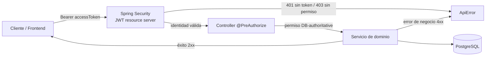

# API HiQNet POS

Guía de consumo de la API REST, pensada para el **Frontend** (y para cualquier
cliente HTTP). El contrato técnico (paths, requests, responses, schemas y
esquema de seguridad) lo **genera** `springdoc-openapi` a partir del código;
este directorio es la capa humana que explica cómo usarlo.

## Transición Rust

La foundation Rust todavía **no expone HTTP ni IPC** y no promete compatibilidad
`/api/v1`. Este contrato Java sigue siendo la referencia oficial; autenticación,
rutas protegidas y errores se prueban contra Java, no contra un endpoint Rust
simulado. No se han cambiado rutas, DTOs, permisos ni OpenAPI en este incremento.
Ver [matriz AS-IS](../05-development/rust-parity-baseline.md) y
[alcance Rust](../05-development/rust-foundation.md). Las pruebas diferenciales
quedan pendientes hasta existir el adaptador de transporte y sus casos de uso.

### Contratos Rust Local (1W)

La [guía Rust Local](rust-local-integration.md) explica el inventario generado de
32 casos de uso, los bindings TypeScript/JSON Schema y la prueba real
Rust → cliente TypeScript → SQLite. La vertical está **aislada en laboratorio**;
no añade endpoints HTTP, comandos Tauri ni login comercial.

## Especificación viva (OpenAPI)

| Recurso | URL (desarrollo local) |
| --- | --- |
| Swagger UI | <http://localhost:8080/swagger-ui/index.html> |
| OpenAPI JSON | <http://localhost:8080/v3/api-docs> |

- La UI y el JSON se exponen **solo** cuando `app.security.permit-opendoc=true`
  (activo en el perfil `dev`; **desactivado en producción** por
  deny-by-default, que responde `401 AUTHENTICATION_REQUIRED`). Ver
  `docs/04-security/authentication.md`.
- Título: **`HiQNet POS API`**. Versión: la del artefacto (hoy `0.4.0-SNAPSHOT`, tomada de
  `backend/pom.xml` vía filtrado Maven).
- `/swagger-ui.html` redirige a `/swagger-ui/index.html`.
- Para probar endpoints autenticados en Swagger: pulsar **Authorize**, pegar el
  `accessToken` (JWT) y llamar.
- El contrato de error es el schema reutilizable `ApiError`
  (`components.schemas.ApiError`); toda respuesta 4xx/5xx del spec lo referencia.
  Ver [`errors.md`](errors.md).
- Receta end-to-end en la UI: `POST /api/v1/auth/login` → copiar `accessToken` →
  **Authorize** → llamar un endpoint protegido. Ver
  [`authentication.md`](authentication.md).

> La especificación generada es la **fuente de verdad** de requests, responses y
> códigos de estado. Estas guías explican cómo consumirla, no la reemplazan.

## Documentos

| Documento | Contenido |
| --- | --- |
| `api-guidelines.md` | Convenciones canónicas (base path, semántica HTTP, PATCH, contrato de error completo, validación, aislamiento entre organizaciones). |
| [`authentication.md`](authentication.md) | Login, refresh, logout y uso del Bearer. |
| [`organization-and-branch-context.md`](organization-and-branch-context.md) | Scoping Organization → Branch y catálogo de permisos. |
| [`pagination.md`](pagination.md) | Contrato `PageResponse`. |
| [`errors.md`](errors.md) | Forma del error y cómo manejarlo desde el Frontend. |
| [`frontend-integration.md`](frontend-integration.md) | Guía práctica (base URL, decimales/moneda, concurrencia, checklist). |
| `inventory-recipes.md` | Recipes y efectos de inventario (detalle de dominio, V18). |
| [`purchasing-suppliers.md`](purchasing-suppliers.md) | Proveedores de Purchasing (V22): permisos, rutas, filtros, concurrencia y ejemplos. |
| [`purchasing-purchase-orders.md`](purchasing-purchase-orders.md) | Órdenes de compra (V23): borradores, partidas, snapshots, permisos, concurrencia y ejemplos. |

## Convenciones base

- Prefijo **`/api/v1`**, JSON, claves en **`camelCase`**, recursos en **plural** y
  sin sufijos verbales (`/organizations`, no `/getOrganizations`).
- IDs de subrecursos en la ruta:
  `/organizations/{organizationId}/branches/{branchId}/...`.
- **Sin `DELETE`**: la baja es `status = INACTIVE` (no hay hard delete sobre
  datos que luego serán financieros).
- Errores: siempre la envoltura `ApiError` (ver [`errors.md`](errors.md)).
- El detalle completo de cada regla está en `api-guidelines.md`.

## Dominios (tags de Swagger)

Cada módulo expone sus endpoints bajo un **tag** de Swagger equivalente a su
dominio. Rutas base relativas a `/api/v1`:

| Tag | Rutas base | Permiso(s) principales |
| --- | --- | --- |
| Authentication | `/auth` | público (`login`/`refresh`/`logout`); Bearer (`me`, `logout-all`) |
| Bootstrap | `/bootstrap` | `X-Bootstrap-Token` (one-shot, **no** Bearer) |
| Organizations | `/organizations/{organizationId}` | `organization.read` / `organization.update` |
| Branches | `/organizations/{organizationId}/branches` | `branch.read` / `branch.create` / `branch.update` |
| Users | `/organizations/{organizationId}/users` | `user.read` / `user.create` / `user.update` |
| RBAC | `/organizations/{organizationId}/roles`, `/permissions`, `/users/{userId}/roles` | `role.*`, `permission.read`, `role.assign`, `role.permissions.manage` |
| Branch Memberships | `/organizations/{organizationId}/branches/{branchId}/memberships` | `branch.membership.*` |
| Catalog | `/organizations/{organizationId}/categories`, `/products` | `category.*`, `product.*` |
| Modifiers | `/organizations/{organizationId}/modifier-groups`, `/products/{productId}/modifier-groups` | `modifier.group.*`, `modifier.option.*`, `product.modifiers.manage` |
| POS Catalog | `/organizations/{organizationId}/branches/{branchId}/pos/catalog` | `pos.catalog.read` |
| Cash Registers | `/organizations/{organizationId}/branches/{branchId}/cash-registers` | `cash-register.*` |
| Cash Shifts | `.../cash-registers/{cashRegisterId}/cash-shifts` | `cash-shift.read` / `cash-shift.open` / `cash-shift.close` |
| Sales | `.../cash-shifts/{cashShiftId}/sales` | `sale.read` / `sale.create` / `sale.update` / `sale.checkout` / `sale.cancel`, `payment.read` |
| Inventory Items | `/organizations/{organizationId}/inventory-items` | `inventory.item.read` / `inventory.item.write` |
| Branch Stock | `.../branches/{branchId}/inventory-items` | `inventory.stock.read` / `inventory.stock.adjust` |
| Recipes | `/organizations/{organizationId}/products/{productId}/inventory-recipe` | `inventory.recipe.read` / `inventory.recipe.write` |
| Inventory Effects | `/organizations/{organizationId}/modifier-options/{modifierOptionId}/inventory-effects` | `inventory.recipe.read` / `inventory.recipe.write` |
| Purchasing Suppliers | `/organizations/{organizationId}/suppliers` | `purchasing.supplier.read` / `purchasing.supplier.write` |
| Purchasing Purchase Orders | `/organizations/{organizationId}/branches/{branchId}/purchase-orders` | `purchasing.order.read` / `purchasing.order.write` |
| Purchasing Purchase Receipts | `.../purchase-orders/{purchaseOrderId}/receipts` | `purchasing.receipt.read` / `purchasing.receipt.write` |
| Audit | `/organizations/{organizationId}/audit-events` | `audit.read` (solo lectura) |

## Ciclo de una petición

El JWT aporta **identidad** (`sub`, `org_id`); la **autorización** la decide el
backend consultando PostgreSQL (permisos), nunca el token. Ver
[`authentication.md`](authentication.md) y `docs/04-security/rbac.md`.
