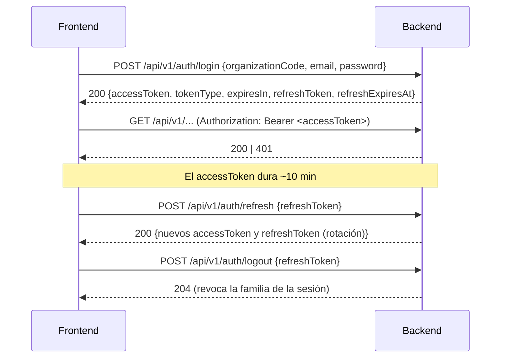

# Autenticación (consumo desde el cliente)

Cómo un cliente obtiene y usa credenciales contra la API. El detalle interno del
módulo `auth` (protecciones, locking, base de datos) vive en
`docs/04-security/authentication.md`; aquí se documenta lo que necesita el
Frontend.

## Flujo



## Endpoints

| Método | Ruta | Auth | Descripción |
| --- | --- | --- | --- |
| POST | `/api/v1/auth/login` | público | Autentica con `organizationCode` + `email` + `password`. |
| POST | `/api/v1/auth/refresh` | público | Rota el refresh token y emite tokens nuevos. |
| POST | `/api/v1/auth/logout` | público | Revoca la sesión presentada (no necesita access token). |
| POST | `/api/v1/auth/logout-all` | Bearer | Revoca todas las sesiones del usuario autenticado. |
| GET | `/api/v1/auth/me` | Bearer | Identidad actual + contexto operativo de la organización. |
| GET | `/api/v1/auth/me/branches` | Bearer | Sucursales visibles para la identidad (paginado). |

### `POST /auth/login`

```json
{ "organizationCode": "cafeteria-central", "email": "admin@example.com", "password": "********" }
```

### Respuesta (login y refresh)

```json
{
  "accessToken": "eyJ...",
  "tokenType": "Bearer",
  "expiresIn": 600,
  "refreshToken": "ab3Q_9...",
  "refreshExpiresAt": "2026-11-07T00:00:00Z"
}
```

- `accessToken`: JWT de vida corta (**~10 minutos**). Va en
  `Authorization: Bearer <accessToken>`.
- `refreshToken`: opaco, entregado **una sola vez**; el servidor no lo almacena
  en claro. Vida ~30 días (con tope absoluto de familia).
- `expiresIn`: segundos de vida del access token.

### `GET /auth/me`

Devuelve la identidad y el **contexto operativo** de la organización (que el
servidor resuelve desde la base de datos, nunca desde el token):

```json
{
  "userId": "uuid",
  "organizationId": "uuid",
  "email": "admin@example.com",
  "status": "ACTIVE",
  "organization": { "currency": "MXN", "locale": "es-MX", "timezone": "America/Mexico_City" }
}
```

Usar `organization.currency` / `locale` / `timezone` para formatear importes,
textos y fechas en el cliente.

## El access token (JWT)

El token es **solo identidad**. Contiene:

| Claim | Significado |
| --- | --- |
| `sub` | UUID del usuario. |
| `org_id` | UUID de la organización del usuario. |
| `token_type` | Tipo de token (`access`). |

**No** contiene roles ni permisos: la autorización es *database-authoritative*
(el backend consulta PostgreSQL con `@PreAuthorize`). Por eso el Frontend no
debe inferir permisos desde el JWT; si necesita saber qué puede hacer, consulte
los endpoints correspondientes o el catálogo de permisos
(`GET /organizations/{organizationId}/permissions`) y los roles del usuario.
Ver [`organization-and-branch-context.md`](organization-and-branch-context.md)
y `docs/04-security/rbac.md`.

## Uso en Swagger UI

1. `POST /api/v1/auth/login` con `organizationCode`, `email` y `password` (usa
   una cuenta de desarrollo; ver `docs/05-development/local-development.md`) y
   copia `accessToken` de la respuesta.
2. Pulsa **Authorize** (arriba a la derecha), pega el token y confirma. Pega
   **únicamente** el `accessToken`; **no** escribas el prefijo `Bearer` (Swagger
   lo añade por ti). Swagger enviará `Authorization: Bearer <token>` en cada
   llamada.
3. Llama a un endpoint protegido (p. ej. `GET /api/v1/auth/me`) y revisa el `200`
   con la identidad y el contexto operativo.

Para salir del esquema en la UI: **Authorize → Logout**.

### Probar 401 / 403 / 409 en Swagger

- **401** — sin autorizar (o tras **Authorize → Logout**), llama un endpoint
  protegido: `AUTHENTICATION_REQUIRED`. Con token inválido/expirado:
  `TOKEN_INVALID` / `TOKEN_EXPIRED`.
- **403** — autentícate con un usuario **sin** el permiso del endpoint (p. ej. un
  cajero llamando una ruta de administración): `FORBIDDEN`.
- **409** — en una mutación, reenvía el `PATCH`/`PUT` con un `expectedVersion`
  desactualizado: `CONCURRENT_MODIFICATION`; o repite un `POST` con un `code` ya
  existente: el `*_ALREADY_EXISTS` correspondiente.
- Todas las respuestas de error usan el schema `ApiError` (ver
  [`errors.md`](errors.md)).

## Errores de autenticación

| Código | HTTP | Cuándo |
| --- | --- | --- |
| `INVALID_CREDENTIALS` | 401 | Login fallido (organización, email o password). Genérico a propósito. |
| `INVALID_REFRESH_TOKEN` | 401 | Refresh desconocido, consumido, revocado o de familia muerta. |
| `AUTHENTICATION_REQUIRED` | 401 | Falta el access token. |
| `TOKEN_INVALID` | 401 | Access rechazado (firma, emisor, audiencia, tipo o identidad no operativa). |
| `TOKEN_EXPIRED` | 401 | Access token expirado. |

Recomendación para el cliente: ante un `401` con `TOKEN_EXPIRED` (o cualquier
`401` distinto de `INVALID_CREDENTIALS`), intentar **un** `refresh`; si también
falla, forzar re-login. Ver [`errors.md`](errors.md).
