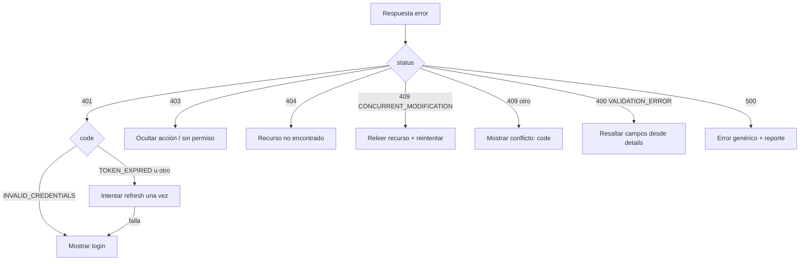

# Errores

Forma estable de los errores de la API y cómo manejarlos desde el Frontend.
Referencia canónica y tabla completa de códigos: `api-guidelines.md`
(§ Contrato de error).

## Envoltura `ApiError`

Todas las respuestas de error (4xx y 5xx) tienen la misma forma:

```json
{
  "timestamp": "2026-10-07T12:00:00Z",
  "status": 409,
  "code": "BRANCH_CODE_ALREADY_EXISTS",
  "message": "A branch with this code already exists in the organization",
  "path": "/api/v1/organizations/…/branches",
  "details": []
}
```

| Campo | Tipo | Significado |
| --- | --- | --- |
| `timestamp` | string (UTC ISO-8601) | Instante del error. |
| `status` | number | Espejo del código HTTP. |
| `code` | string | **Código estable**; es lo que el cliente debe programar, no el `message`. |
| `message` | string | Mensaje legible, genérico; no exponerlo como verdad de negocio. |
| `path` | string | Ruta solicitada. |
| `details` | string[] | Detalles opcionales (p. ej. errores de validación). Puede ser `[]`. |

**Nunca** se exponen stack traces, mensajes SQL ni detalles internos.

## El error en OpenAPI / Swagger

La forma del error no se adivina: la especificación la expone como el schema
reutilizable **`ApiError`** (`components.schemas.ApiError`), y **cada** respuesta
4xx/5xx de `/v3/api-docs` lo referencia. En Swagger UI se ve en el panel
**Schemas** y en el **Example Value** de cualquier respuesta de error.

- El schema lo registra `OpenApiConfig` (`apiErrorSchemaCustomizer`) a partir del
  record `ApiError`; es puramente documental y **no** cambia el contrato en
  runtime.
- La envoltura es idéntica en runtime: `GlobalExceptionHandler` (negocio,
  validación, `404/409/500`) y `ApiSecurityErrorHandler` (`401/403` de la cadena
  de seguridad) siempre serializan `ApiError`.

## Validación

Los errores de Bean Validation llegan como `400 VALIDATION_ERROR` con la lista de
campos inválidos en `details`:

```json
{
  "status": 400,
  "code": "VALIDATION_ERROR",
  "message": "Validation failed",
  "path": "/api/v1/organizations/…/products",
  "details": ["unitPrice: must be greater than or equal to 0"]
}
```

`409 INSUFFICIENT_INVENTORY` (checkout) usa `details` para listar los faltantes:

```json
{
  "status": 409,
  "code": "INSUFFICIENT_INVENTORY",
  "message": "Insufficient inventory to complete the sale",
  "details": ["CAFE-01 required=2.000000 available=0.500000"]
}
```

`409 INVENTORY_ITEM_UNIT_LOCKED` (catálogo) rechaza cambiar la unidad base de un
artículo que ya tiene dependencias; el mensaje explica el motivo para que el
frontend pueda mostrarlo:

```json
{
  "status": 409,
  "code": "INVENTORY_ITEM_UNIT_LOCKED",
  "message": "The base unit cannot be changed because the item has dependent inventory facts",
  "path": "/api/v1/organizations/…/inventory-items/…",
  "details": []
}
```

## Semántica HTTP

| HTTP | Significado |
| --- | --- |
| 400 | Validación o body mal formado (`VALIDATION_ERROR`, `MALFORMED_REQUEST`). |
| 401 | No autenticado (`AUTHENTICATION_REQUIRED`, `TOKEN_EXPIRED`, `TOKEN_INVALID`, `INVALID_CREDENTIALS`, `INVALID_REFRESH_TOKEN`). |
| 403 | Autenticado sin permiso (`FORBIDDEN`). |
| 404 | Recurso inexistente o de otra organización. |
| 409 | Conflicto: duplicado, estado o modificación concurrente (`CONCURRENT_MODIFICATION`, `INVENTORY_ITEM_UNIT_LOCKED`). |
| 500 | Error interno (`INTERNAL_ERROR`). |

## Cómo manejarlos (Frontend)



Reglas prácticas:

- **Conmutar por `code`**, no por `message` ni por texto.
- **`409 CONCURRENT_MODIFICATION`**: el cliente envió un `expectedVersion`
  desactualizado. Releer el recurso, aplicar el cambio sobre el estado fresco y
  reenviar (ver [`frontend-integration.md`](frontend-integration.md)).
- **`401`**: un único intento de `refresh`; si falla, re-login
  (ver [`authentication.md`](authentication.md)).
- **`403`**: no es un error de sesión; el usuario no tiene el permiso. No
  reintentar con el mismo token.
- **`404`** en recursos de otra organización: no distinguir de “no existe”.

> La tabla exhaustiva de códigos estables (con su HTTP y condición) está en
> `api-guidelines.md`.
