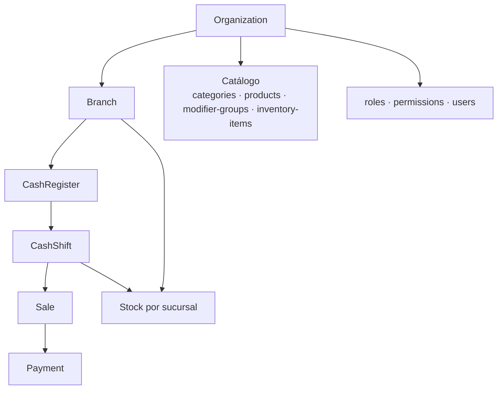

# Contexto Organization / Branch

Modelo de scoping de la API y su relación con la autorización. Fuente canónica:
`docs/02-database/organization-branch-model.md`, `docs/04-security/rbac.md` y
`docs/01-architecture/adr/0003-organization-and-branch-boundaries.md`.

## Modelo de recursos

Todo cuelga de una **organización** (tenant) y, cuando es operativo, de una
**sucursal** (branch):



- Los **catálogos** (productos, ingredientes, modifiers) pertenecen a la
  **organización**.
- Las **existencias de inventario** pertenecen a la **sucursal**.
- Las rutas operativas usan la branch como **contexto de autorización**; no
  crean catálogo branch-owned ni precios por branch.

## El identificador de organización siempre va en la ruta

Salvo `auth` y `bootstrap`, todas las rutas llevan
`/organizations/{organizationId}` y anidan la branch cuando aplica:

```text
/api/v1/organizations/{organizationId}/branches/{branchId}/cash-registers/{cashRegisterId}/cash-shifts/{cashShiftId}/sales
```

## La branch NO está en el token

El JWT contiene únicamente `sub` (usuario) y `org_id` (organización). **No**
existe un claim de branch: elegir la sucursal activa es una decisión del cliente.
Para saber qué sucursales puede usar la identidad:

| Endpoint | Resultado |
| --- | --- |
| `GET /api/v1/auth/me` | Contexto de la organización (`currency`, `locale`, `timezone`). |
| `GET /api/v1/auth/me/branches` | Sucursales visibles (paginado; filtros `status`, `q`). |

`GET /auth/me/branches` es **visibilidad, no autorización**: con `branch.read`
org-wide lista todas las sucursales de la organización; sin él, solo aquellas
donde el usuario tiene una membership `ACTIVE`. Una branch `INACTIVE` sigue
siendo descubrible para sus miembros.

## Autorización: organization-wide vs branch-scoped

| Alcance | Comprobación | Regla |
| --- | --- | --- |
| Organization-wide | `hasOrganizationPermission` | El permiso debe estar asignado a nivel organización. |
| Branch-scoped | `hasBranchPermission` | Vale un permiso **organization-wide** **o** una membership `ACTIVE` de **esa** branch. |

Las rutas de **gestión de memberships** se autorizan **siempre** con permisos
organization-wide (`branch.membership.*`), nunca branch-scoped
(anti privilege-escalation).

## Aislamiento y códigos

| Situación | HTTP | Código |
| --- | --- | --- |
| Sin token | 401 | `AUTHENTICATION_REQUIRED` |
| Sin permiso (frontera de autorización) | 403 | `FORBIDDEN` |
| Recurso de **otra** organización (permiso válido en la org de la ruta) | 404 | p. ej. `BRANCH_NOT_FOUND`, `PRODUCT_NOT_FOUND` |

Un id de otra organización **nunca** se filtra en silencio a una página vacía:
responde `404`. Ver `api-guidelines.md`.

## Catálogo de permisos (51)

Se siembran por Flyway y son la autoridad. Agrupados por dominio:

| Dominio | Códigos |
| --- | --- |
| Organización | `organization.read`, `organization.update` |
| Branch | `branch.read`, `branch.create`, `branch.update` |
| Usuarios | `user.read`, `user.create`, `user.update` |
| RBAC | `role.read`, `role.create`, `role.update`, `role.assign`, `role.permissions.manage`, `permission.read` |
| Memberships | `branch.membership.read`, `branch.membership.create`, `branch.membership.update`, `branch.membership.roles.manage` |
| Catálogo | `category.read`, `category.create`, `category.update`, `product.read`, `product.create`, `product.update`, `product.modifiers.manage` |
| Modifiers | `modifier.group.read`, `modifier.group.create`, `modifier.group.update`, `modifier.option.read`, `modifier.option.create`, `modifier.option.update` |
| POS Catalog | `pos.catalog.read` |
| Cajas | `cash-register.read`, `cash-register.create`, `cash-register.update` |
| Turnos | `cash-shift.read`, `cash-shift.open`, `cash-shift.close` |
| Ventas | `sale.read`, `sale.create`, `sale.update`, `sale.checkout`, `sale.cancel`, `payment.read` |
| Inventario | `inventory.item.read`, `inventory.item.write`, `inventory.stock.read`, `inventory.stock.adjust`, `inventory.recipe.read`, `inventory.recipe.write` |
| Auditoría | `audit.read` |

- `POST /api/v1/organizations` **no** tiene permiso: permanece cerrado
  (deny-by-default). La primera organización se crea con
  `POST /api/v1/bootstrap` (provisioning one-shot).
- El catálogo se puede leer en `GET /organizations/{organizationId}/permissions`.
