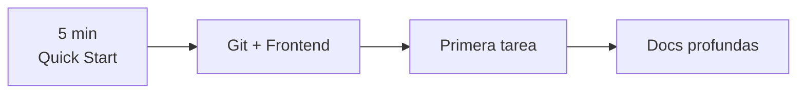
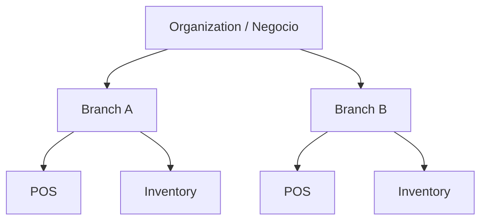
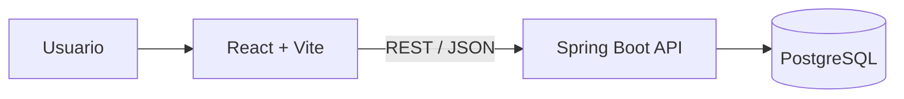
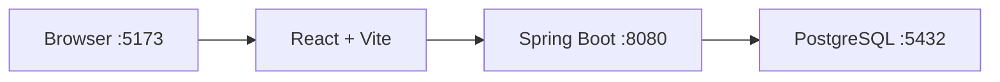
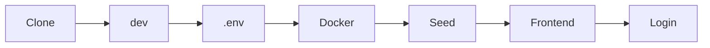
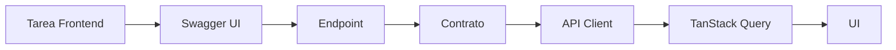
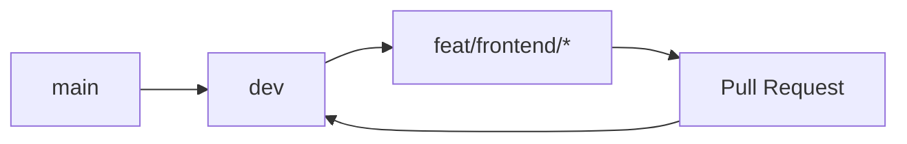
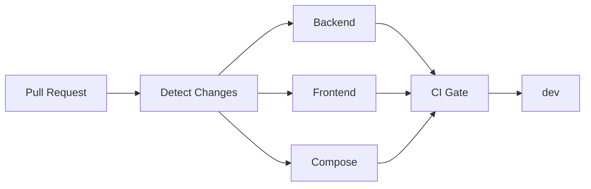
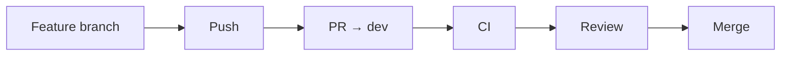
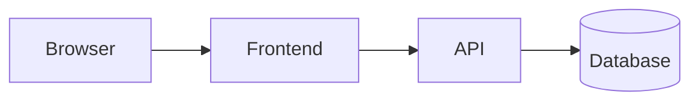

# Onboarding de colaboradores — HiQNet POS

Guía visual para tu **primer día** en HiQNet POS. Está pensada sobre todo para
desarrollo **Frontend**: no necesitas leer antes los ADRs, el código del backend
ni toda la documentación técnica. Cuando necesites profundidad, esta guía te dice
**dónde mirar**.

> Resumen de una frase: **HiQNet POS es un sistema punto de venta comercial
> multisucursal** (Organization → Branch), construido como *modular monolith*
> Spring Boot + React.

## Ruta de lectura

```text
5 minutos   → Quick Start
10–15 min   → Git + Frontend + API (Swagger)
Cuando haga falta → documentación profunda (enlaces al final)
```



## 1. ¿Qué es HiQNet POS?

Un **sistema de punto de venta** para pequeños negocios de alimentos y retail
ligero. Modelo de datos multisucursal desde el diseño inicial:



- El **catálogo** (productos, ingredientes, modificadores) pertenece a la
  **Organization**.
- Las **existencias de inventario** pertenecen a la **Branch** (sucursal).

Contexto de producto: `docs/00-product/product-vision.md`,
`docs/00-product/scope-v1.md` y `docs/00-product/roadmap.md`.

## 2. Arquitectura general

Un único backend Spring Boot + una SPA React. **Sin microservicios.**



- **Flyway** es la única autoridad de schema (migraciones `V1`–`V21`).
- Detalle: `docs/01-architecture/architecture.md` y los ADR en
  `docs/01-architecture/adr/`.

## 3. Stack (verificado contra el repo)

| Área | Tecnología |
| --- | --- |
| Frontend | React + TypeScript + Vite |
| UI | MUI |
| Server state | TanStack Query |
| Routing | React Router |
| Backend | Java 21 + Spring Boot |
| Base de datos | PostgreSQL 17 |
| Migraciones | Flyway |
| Infra local | Docker Compose |
| API docs | OpenAPI + Swagger UI |
| E2E | Playwright |
| CI | GitHub Actions |

Versiones exactas en `README.md` y `frontend/package.json`.

## 4. Entorno local (concepto)

```text
HOST
└── Frontend Vite (o nada, si usas Docker full)

DOCKER
├── PostgreSQL
└── Spring Boot Backend
```



## 5. Requisitos

- **Git** + **Docker** con el plugin Compose — modo full-stack.
- **Node.js 24 LTS** (`>=22.12`) + **pnpm 11** (`corepack enable`) — solo para el
  modo híbrido de frontend.

El backend corre con el **Maven Wrapper dentro de Docker**: **no necesitas Java
ni Maven en tu máquina**. Tampoco PostgreSQL en el host.

## 6. Quick Start (el camino más corto)



### Paso a paso

```bash
# 1. Clone
git clone https://github.com/HiQNet-Dev/point-of-sale.git
cd point-of-sale

# 2. Sitúate en dev
git switch dev
git pull --ff-only

# 3. Crea tu .env (plantilla pública, sin secretos reales)
cp .env.example .env          # Git Bash / Linux / macOS
```

```powershell
# Windows PowerShell
Copy-Item .env.example .env
```

> **Nunca comiences una tarea desde `main`.** `dev` es la rama de integración.

```bash
# 4. Levanta base de datos + backend
docker compose up -d db backend
docker compose ps

# 5. Carga los datos de desarrollo (solo en DB recién creada)
docker compose --profile tools run --rm seed

# 6. Levanta el frontend en local
cd frontend
pnpm install
pnpm dev
```

Abre <http://localhost:5173> e inicia sesión con una cuenta de desarrollo
(siguiente sección).

## 7. Archivo `.env`

- `.env.example` = **plantilla pública** (valores de desarrollo, sin secretos).
- `.env` = **tu configuración local**.
- `.env` **no se commitea** (está en `.gitignore`). Nunca subas secretos.

## 8. Cuentas de desarrollo (DEVELOPMENT ONLY)

Credenciales ficticias, a propósito inseguras. **Nunca** para datos reales.

| Cuenta | Email | Password | Uso |
| --- | --- | --- | --- |
| Administrador | `admin@hiqnet.local` | `admin-dev-only` | acceso total |
| Manager inventario | `manager@hiqnet.local` | `staff-dev-only` | `/admin` |
| Cajero | `cashier@hiqnet.local` | `staff-dev-only` | `/pos` |

Datos, reset y detalle completo en
`docs/05-development/local-development.md`.

## 9. URLs del entorno local

| Servicio | URL |
| --- | --- |
| Frontend | <http://localhost:5173> |
| Backend | <http://localhost:8080> |
| Health | <http://localhost:8080/actuator/health> |
| Swagger UI | <http://localhost:8080/swagger-ui/index.html> |
| OpenAPI JSON | <http://localhost:8080/v3/api-docs> |
| PostgreSQL | `localhost:5432` |

## 10. Swagger / OpenAPI (parte central del flujo Frontend)

La API vive bajo `/api/v1`. La especificación OpenAPI se **genera desde el
código** y está disponible **solo en desarrollo**.



### ¿Cómo sé qué endpoint usar? (60 segundos)

```text
1. Abre Swagger UI.
2. Busca el módulo (tag) correspondiente.
3. Abre el endpoint.
4. Revisa el request (body / params).
5. Revisa el response (schema).
6. Revisa los HTTP status.
7. Revisa la permission requerida.
8. Implementa el API client.
```

> La especificación generada es la **fuente de verdad** del contrato. No la
> reemplacemos con mocks ni con copias.

## 11. Documentación de la API

| Documento | Contenido |
| --- | --- |
| `docs/03-api/README.md` | Panorama: tags, convenciones base, ciclo de una petición. |
| `docs/03-api/api-guidelines.md` | Convenciones canónicas (reglas + tabla de errores). |
| `docs/03-api/authentication.md` | Login, refresh, logout, uso del Bearer. |
| `docs/03-api/errors.md` | Forma del error y cómo manejarlo desde el Frontend. |
| `docs/03-api/organization-and-branch-context.md` | Scoping Organization → Branch y permisos. |
| `docs/03-api/pagination.md` | Contrato `PageResponse`. |
| `docs/03-api/frontend-integration.md` | Guía práctica (base URL, decimales/dinero, concurrencia). |
| `docs/03-api/inventory-recipes.md` | Recipes y efectos de inventario. |

## 12. Autenticación y "Authorize" en Swagger

```text
POST /auth/login  →  accessToken (JWT ~10 min)
Pulsar "Authorize" en Swagger  →  Bearer <accessToken>
Llamar a endpoints protegidos
```

- El JWT es **solo identidad** (`sub`, `org_id`, `token_type`): **no** contiene
  roles ni permisos.
- **No** pongas tokens reales en el repo ni en capturas.

Detalle: `docs/03-api/authentication.md`.

## 13. Errores de la API

```text
NO parsees `message` para decidir.

Decide por:
  HTTP status  +  `error.code` estable
```

- Conmutar por `code`, nunca por texto.
- La envoltura `ApiError` es siempre
  `{ timestamp, status, code, message, path, details }`.

Detalle: `docs/03-api/errors.md`.

## 14. Organization / Branch: ownership

```text
Organization
├── Branch A  →  Stock A
└── Branch B  →  Stock B
```

> **Siempre piensa en ownership.** Catálogo = organización; existencias =
> sucursal. No mezcles datos entre Branches.

Detalle: `docs/03-api/organization-and-branch-context.md`.

## 15. Seguridad desde el Frontend

> El Frontend **no** es autoridad de seguridad. Ocultar un botón mejora la UX;
> **el backend sigue siendo quien autoriza**.

- **No** hardcodees roles (`ADMIN`, `MANAGER`, `CASHIER`) como mecanismo de
  autorización. El sistema es **permission-based** (RBAC en base de datos).
- Toda validación y autorización es **server-side**.

Detalle: `docs/04-security/security-model.md` y `docs/04-security/rbac.md`.

## 16. Estructura del Frontend

```text
frontend/src/
├── app/            # bootstrap: config, providers, router, pages de arranque
│   ├── config/     #   env.ts (API_BASE_URL desde VITE_API_BASE_URL)
│   ├── providers/  #   AppProviders (React Query, MUI, sesión)
│   └── router/     #   definición de rutas
├── shared/         # infraestructura transversal
│   └── api/        #   client.ts (fetch + Bearer + refresh + decimales), pagination
└── features/       # módulos de negocio, cada uno con su estructura interna
    ├── auth/
    ├── pos-session/
    ├── pos-sales/
    ├── inventory-items/
    ├── inventory-stock/
    ├── inventory-recipes/
    ├── inventory-modifier-effects/
    ├── inventory-settings/
    └── admin-shell/
```

Cada `feature` sigue el mismo patrón:

```text
features/<feature>/
├── api/         # llamadas a la API (usan shared/api/client.ts)
├── components/  # UI local de la feature
├── model/       # estado, hooks, keys de Query, tipos
└── pages/       # rutas/pantallas
```

## 17. Flujo de una feature Frontend

```text
Page / Component  →  Query / Mutation  →  API Client  →  REST API  →  PostgreSQL
```

- **Query** → lectura.
- **Mutation** → cambio (POST/PATCH).

No hay lógica de negocio crítica en React: el servidor es la fuente de verdad.

## 18. Query keys y contexto de Branch

Las keys viven en `features/<feature>/model/<feature>Keys.ts`. Los datos
branch-scoped incluyen el contexto suficiente:

```ts
// Ejemplo real: features/pos-session/model/posSessionKeys.ts
registers: (organizationId: string, branchId: string, page: number, size: number, q = '') =>
  ['cash-registers', organizationId, branchId, page, size, q] as const,
```

> **Branch A ≠ Branch B.** Si una key no distingue `organizationId`/`branchId`,
> la caché puede mezclar sucursales. Sigue el patrón real de la feature; no
> inventes una estructura nueva.

## 19. Decimales de inventario (MUY IMPORTANTE)

Las cantidades de inventario viajan como **string** para no perder precisión:

```json
{ "quantityOnHand": "100.000000" }
```

- Enviar el string **tal cual** (`"2.500000"`), sin `parseFloat`.
- No convertir a operaciones de punto flotante cuando la precisión importe.

## 20. Dinero

El contrato de **money** es distinto al del decimal de inventario:

- **Dinero = `number`** (p. ej. `product.unitPrice`, `sale.totalAmount`,
  `payment.amount`).
- **Cantidad de línea de venta = integer** (`saleItem.quantity`).

Detalle y tabla completa: `docs/03-api/frontend-integration.md`.

## 21. Concurrencia optimista (`expectedVersion`)

- Toda mutación versionada exige `expectedVersion` (en ventas,
  `expectedSaleVersion`): la versión que **leyó** el cliente.
- Si no coincide → **`409 CONCURRENT_MODIFICATION`**.
- Patrón: leer → mutar con la versión leída → si `409`, releer y reintentar.

## 22. Modelo Git



- **`main`** = estable / release. No se desarrolla aquí.
- **`dev`** = integración y preproducción de la próxima release.
- **feature branch** = tarea temporal, nace de `dev` y vuelve a `dev` por PR.

## 23. Regla principal de Git

> **ANTES DE CADA TAREA**
>
> ```bash
> git switch dev
> git pull --ff-only
> git switch -c feat/frontend/<mi-feature>
> ```

Nunca programes directamente sobre `main` ni `dev`.

## 24. Ramas: nombres correctos

- ❌ `juan`, `pedro`, `frontend`, `mi-rama`, `developer`
- ✅ Una rama nueva por tarea:

```text
feat/frontend/sales-history
feat/frontend/customer-search
fix/frontend/checkout-feedback
```

Prefijos válidos: `feat/*`, `fix/*`, `chore/*`, `docs/*`, `test/*`,
`refactor/*`, `hotfix/*`. Detalle: `docs/05-development/git-workflow.md`.

## 25. No worktrees

No usamos **worktrees** como flujo normal. Se trabaja en **un único checkout**
con `git switch`. Un worktree solo con justificación documentada en el PR.

## 26. Flujo diario (60 segundos)

```bash
git switch dev
git pull --ff-only
git switch -c feat/frontend/mi-feature

# desarrollar

cd frontend
pnpm lint
pnpm typecheck
pnpm test
pnpm build

cd ..
git status
git add .
git commit -m "feat(frontend): ..."
git push -u origin feat/frontend/mi-feature
```

Después: **Pull Request → `dev`**.

## 27. Conventional Commits

```text
feat(frontend): add sales history
fix(frontend): handle stock loading state
test(frontend): cover checkout conflict
docs: update collaborator guide
```

## 28. Tests y verificación Frontend (scripts reales)

```bash
cd frontend
pnpm lint           # ESLint
pnpm typecheck      # tsc -b
pnpm test           # Vitest
pnpm build          # tsc -b + vite build
pnpm typecheck:e2e  # si tu cambio toca el harness E2E
```

## 29. Checklist antes de push

```text
[ ] Estoy en mi feature branch
[ ] Mi branch nació de dev actualizado
[ ] La feature funciona
[ ] Revisé loading / error / empty state
[ ] Revisé responsive (mobile / tablet / desktop)
[ ] lint pasa
[ ] typecheck pasa
[ ] tests pasan
[ ] build pasa
[ ] No agregué secrets
[ ] No subí .env
[ ] No cambié Backend accidentalmente
```

## 30. UI, TypeScript y accesibilidad

- Usa **MUI** y los componentes/patrones **existentes** antes de crear otra
  solución. **No** agregues otra UI library.
- Evita `any`, `@ts-ignore` y `as unknown as` salvo justificación excepcional.
- Accesibilidad: `labels`, navegación por teclado, foco visible, controles
  semánticos, feedback de estado/error y sin significado solo por color.

## 31. ¿Y si el endpoint no existe?

> **NO inventes el contrato.**

```text
Frontend necesita un dato
        ↓
Swagger no tiene el endpoint
        ↓
hablar con el responsable Backend
        ↓
definir el contrato
        ↓
Backend llega a dev
        ↓
Frontend consume
```

## 32. Backend real > mock global

Para el desarrollo normal: **backend real local + PostgreSQL real** (Docker).
Los mocks sirven para **tests unitarios** y casos aislados; nunca son la fuente
del contrato.

## 33. CI (visión general)



- Corren **solo los jobs necesarios** (según las áreas modificadas).
- **E2E** integrado: en PR / `dev` normalmente **SKIPPED**; se ejecuta en
  `main` y en la validación manual completa.
- **CI Gate** = resultado agregado. Debe estar **verde** antes de integrar.

## 34. SKIPPED ≠ ERROR

Un job **SKIPPED** puede ser completamente correcto. Ejemplo para un cambio
**docs-only**:

```text
Detect Changes → SUCCESS
Backend        → SKIPPED
Frontend       → SKIPPED
Compose        → SKIPPED
E2E            → SKIPPED
CI Gate        → SUCCESS
```

Detalle de la estrategia: `docs/05-development/ci.md`.

## 35. Pull Request



### Checklist de PR

```text
[ ] Base = dev
[ ] Scope pequeño, un propósito
[ ] Sin archivos accidentales
[ ] Sin secrets
[ ] Tests verdes
[ ] CI Gate verde
[ ] Screenshots si cambia UI
[ ] Descripción clara
[ ] Limitaciones conocidas
```

> **CI verde ≠ merge automático.** Implementas, pruebas, abres el PR y corriges
> el feedback. La integración ocurre cuando está aprobada.

## 36. Después del merge

```bash
git switch dev
git pull --ff-only
git switch -c feat/frontend/nueva-feature
```

- La feature branch **se elimina** (local y remota).
- **No reutilices** branches.

## 37. Troubleshooting

| Problema | Revisar |
| --- | --- |
| Frontend no carga | `pnpm dev`, puerto 5173 |
| API no responde | `docker compose ps` |
| Backend falla | `docker compose logs -f backend` |
| Login falla | seed / backend arriba |
| 401 | token/sesión; intentar un refresh |
| 403 | falta permission |
| 409 | estado / concurrencia / regla de negocio |
| Datos incorrectos | contexto Branch |
| Swagger no abre | perfil `dev` y backend arriba |
| CI falla | el job exacto en Actions |

## 38. Debugging



- Problema visual → **Frontend**.
- `4xx` / `5xx` → **Network** en DevTools + API.
- Backend no inicia → **logs** (`docker compose logs -f backend`).
- Datos equivocados → **API / contexto Branch**.

Usa **DevTools → Network y Console** para el diagnóstico básico.

## 39. Swagger como herramienta de debug

Si no sabes si el fallo está en el Frontend o en el Backend:

```text
prueba el endpoint directamente en Swagger
```

- Si Swagger funciona y el Frontend no → probablemente la integración Frontend.
- No es una regla absoluta, pero descarta rápido.

## 40. Docker cheat sheet

```bash
docker compose up -d db backend        # DB + backend
docker compose ps                      # estado + health
docker compose logs -f backend         # logs en vivo
docker compose down                    # detener (conserva datos)
```

## 41. Reset / Seed

| Acción | Qué hace |
| --- | --- |
| **Seed** | Carga los datos ficticios de desarrollo (una sola vez, DB limpia). |
| **Reset** | Recrea **solo** la DB de desarrollo y vuelve a sembrar. |

```bash
docker compose --profile tools run --rm seed   # o: pnpm dev:seed
pnpm dev:reset                                  # reset determinista
```

> Advertencia: los scripts de seed/reset se **niegan** a correr salvo
> `APP_ENV=development`, DB `hiqnet_pos` y host loopback. **Nunca** apuntes reset
> destructivo fuera de desarrollo.

## 42. Tu primer día (checklist)

```text
[ ] git clone
[ ] git switch dev
[ ] crear .env
[ ] levantar DB + backend (Docker)
[ ] seed
[ ] levantar Frontend (Vite)
[ ] login
[ ] abrir /pos
[ ] abrir /admin
[ ] abrir Swagger UI
[ ] buscar un endpoint
[ ] ver una request en Network
[ ] crear una feature branch de prueba
```

**Onboarding exitoso** = puedes: levantar el stack, loguearte, navegar, abrir
Swagger, identificar un endpoint, entender request/response, crear una branch
desde `dev`, modificar el Frontend, correr los tests, hacer push y abrir un PR a
`dev`.

## 43. NO hagas esto

```text
❌ No programes en main
❌ No programes directamente en dev
❌ No abras PR normal hacia main
❌ No crees rama personal permanente
❌ No crees worktrees por defecto
❌ No subas .env
❌ No subas secrets
❌ No edites migraciones históricas
❌ No hardcodees roles como seguridad
❌ No mezcles datos entre Branches
❌ No uses force push en main/dev
❌ No inventes contratos API
```

## 44. Sí haz esto

```text
✅ Parte de dev actualizado
✅ Usa una branch pequeña
✅ Sigue patrones existentes
✅ Usa Swagger
✅ Revisa permissions / errors
✅ Prueba responsive
✅ Maneja loading / error / empty
✅ Ejecuta lint/typecheck/tests/build
✅ PR → dev
✅ Corrige feedback
✅ Pregunta cuando cambie dominio/API
```

## 45. Cómo pedir ayuda

Comparte:

```text
- branch
- feature
- qué esperabas
- qué ocurrió
- error exacto
- request de Network (si aplica)
- logs
- pasos para reproducir
```

## 46. Glosario

| Término | Significado |
| --- | --- |
| `main` | Rama estable / release. |
| `dev` | Rama de integración y preproducción. |
| feature branch | Rama short-lived por tarea, nace de `dev`. |
| PR | Pull Request; se abre hacia `dev`. |
| CI | GitHub Actions: valida el repo. |
| CI Gate | Check agregado; debe estar verde. |
| E2E | Pruebas Playwright de extremo a extremo. |
| Swagger | UI que muestra el contrato OpenAPI. |
| OpenAPI | Especificación del contrato REST, generada del código. |
| seed | Datos de desarrollo ficticios. |
| Flyway | Migraciones de base de datos. |
| Organization | Tenant / negocio dueño del catálogo. |
| Branch | Sucursal dueña de las existencias. |
| RBAC | Autorización basada en permisos (DB-authoritative). |
| permission | Unidad atómica de autorización. |

## 47. Mapa de documentación

```text
Onboarding        → docs/05-development/collaborator-onboarding.md

API               → docs/03-api/README.md
  convenciones    → docs/03-api/api-guidelines.md
  autenticación   → docs/03-api/authentication.md
  errores         → docs/03-api/errors.md
  org/branch      → docs/03-api/organization-and-branch-context.md
  paginación      → docs/03-api/pagination.md
  integración FE  → docs/03-api/frontend-integration.md

Git               → docs/05-development/git-workflow.md
CI                → docs/05-development/ci.md
Desarrollo local  → docs/05-development/local-development.md
Guía de código    → docs/05-development/coding-guidelines.md
Release           → docs/05-development/release-process.md
E2E               → docs/05-testing/pos-e2e.md

Arquitectura      → docs/01-architecture/architecture.md
  ADRs            → docs/01-architecture/adr/
Seguridad         → docs/04-security/security-model.md
  RBAC            → docs/04-security/rbac.md
Producto          → docs/00-product/product-vision.md
  roadmap         → docs/00-product/roadmap.md
Base de datos     → docs/02-database/domain-model.md
```

## 48. Cheat sheet

```bash
# Git
git switch dev
git pull --ff-only
git switch -c feat/frontend/example
git status
git push -u origin feat/frontend/example

# Docker (DB + backend)
docker compose up -d db backend
docker compose ps
docker compose logs -f backend
docker compose --profile tools run --rm seed
docker compose down

# Frontend
cd frontend
pnpm install
pnpm dev
pnpm lint
pnpm typecheck
pnpm test
pnpm build
```

## 49. Windows (PowerShell)

- Copiar plantilla: `Copy-Item .env.example .env`.
- Los scripts de dev son Node puro: no requieren Bash.
- Si el **HMR** no detecta cambios en Windows + Docker Desktop, pon
  `VITE_USE_POLLING=true` en `.env` y reinicia el frontend.
- El backend usa el Maven Wrapper **dentro de la imagen**: no necesitas Maven/Java
  en el host.

## 50. Si solo recuerdas 6 cosas

```text
1. Siempre parte de dev.
2. Nunca programes directamente en main/dev.
3. Backend + DB se levantan con Docker.
4. Frontend corre localmente con Vite.
5. Swagger es tu mapa de la API.
6. Tu PR normal siempre apunta a dev.
```

> **Nunca subas secrets.**
