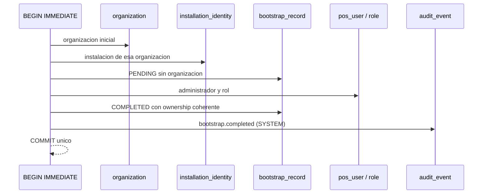

# Expediente de aprobación 1I — contrato físico Auth/RBAC/Audit

**Estado: PENDIENTE DE DECISIÓN DEL TITULAR. Nada de este documento está aprobado.**

Este expediente sustituye la dispersión entre `rust-increment-1i-prep.md`,
`proposals/local-auth/README.md` y el paquete D-AUTH. No crea un índice nuevo: es
el documento único de decisión para promover `0002`–`0007`.

## 1. Cómo leer este expediente

- **Contrato vigente**: lo que hoy exige la fuente normativa o el Design Freeze.
- **Propuesta**: lo que ya está escrito en `proposals/local-auth/000N.proposed.sql`
  y verificado por pruebas.
- **Diferencia**: desviación respecto del contrato vigente.
- **Recomendación**: opinión técnica del agente, **no** una aprobación.
- **Bloquea**: qué migraciones o capacidades no pueden promoverse sin la decisión.

La respuesta del titular se registra en el bloque 7. Mientras ese bloque esté
vacío, el estado sigue siendo PENDIENTE y ninguna migración se traslada a
`backend-rust/migrations/local/`.

## 2. Matriz de decisiones

| ID | Decisión | Contrato vigente | Propuesta verificada | Diferencia | Riesgo | Bloquea |
| --- | --- | --- | --- | --- | --- | --- |
| D-AUTH-01 | Nombres y campos canónicos de `pos_user` | F1–10 §16.4: `id`, `organization_id`, `display_name`, `email`, `status`, versiones y timestamps | `0003` transcribe la ficha con `display_name` | Ninguna | Bajo | `0003` |
| D-AUTH-02 | Catálogo de `local_credential.state` | F1–10 §16.5: `ACTIVE`/`PASSWORD_RESET_REQUIRED` | `0003` limita el `CHECK` a esos dos valores; la desactivación vive en `pos_user.status` | El laboratorio usó `RESET_REQUIRED`/`DISABLED`; el DDL ya no los admite | Medio: obliga a alinear fixtures | `0003`, `0004` |
| D-AUTH-03 | `local_session.state` físico | F1–10 §16.45: columna `state` | `0003` con `ACTIVE`/`REVOKED`/`EXPIRED`; expiración siempre derivada de `expires_at` | Ninguna | Bajo | `0003` |
| D-AUTH-04 | `local_session` sin `organization_id` | F1–10 §16.45: ownership vía `pos_user` | `0003` sin columna de organización; FK a `pos_user` | Ninguna | Bajo | `0003` |
| D-AUTH-05 | Versiones iniciales `1` | F1–10 §16.5 y §16.45 | `credential_version` y `session_version` con `DEFAULT 1` y `CHECK >= 1` | Ninguna | Bajo | `0003` |
| D-AUTH-06 | Catálogo RBAC de 59 permisos | V5–V25 de Java | `0004` reproduce los 59 códigos e idempotencia | Ninguna | Bajo | `0004`, `0005`, `0007` |
| D-AUTH-07 | Atribución de `audit_event.session_id` | F1–10 §17.2: `session_id` nullable | `0006`: USER puede llevar sesión; SYSTEM no puede | Ninguna | Bajo | `0006` |
| D-AUTH-08 | Append-only de auditoría | F4–14 y V7 | `0006`: triggers `BEFORE UPDATE`/`BEFORE DELETE` | Ninguna | Bajo (no es inmutabilidad criptográfica) | `0006` |
| D-AUTH-09 | Parámetros comerciales Argon2id | F4–19 | Solo `LAB_V0`/`LAB_V1` experimentales | Falta benchmark en hardware objetivo e interoperabilidad Java | Alto si se fija sin evidencia | **Bloqueada**; no bloquea el DDL |
| D-AUTH-10 | Bootstrap por instalación | F1–10 §17.3 | `0007`: PK `installation_id`, `PENDING`/`COMPLETED`, FKs compuestas same-org | Ninguna | Medio: exige respetar el orden de arranque | `0007` |
| D-AUTH-11 | Normalización y unicidad de email | F1–10 §16.4; Java usa `toLowerCase(Locale.ROOT)` | Opción A: normalizar en la aplicación y unir sobre el valor canónico | La BD no pliega Unicode; `lower()` de SQLite es ASCII | Medio: escrituras SQL directas podrían crear duplicados semánticos | `0003` |
| D-INST-01 | Catálogo de `installation_identity.status` | F1–10 §16.3: estado inicial `ACTIVE` | `0002`: `CHECK (status IN ('ACTIVE'))` | Catálogo completo sin definir | Bajo | `0002` |
| D-INST-02 | Unicidad y formato de `public_key_fingerprint` | F1–10 §16.3 | `0002`: longitud 1–128, sin `UNIQUE` | Ámbito de unicidad sin decidir | Medio: dos instalaciones podrían declarar la misma huella | `0002` |
| ADR-0022 | Reconciliación contractual 1H→1I | Design Freeze | ADR documenta la restauración del contrato congelado, no un cambio de diseño | Ninguna si se clasifica como restauración | Bajo | Ninguna por sí solo |

### 2.1 Recomendaciones (no aprobaciones)

| ID | Recomendación |
| --- | --- |
| D-AUTH-01..08, D-AUTH-10 | Aprobar tal como están: restauran el contrato congelado y ya tienen pruebas |
| D-AUTH-09 | Mantener bloqueada hasta disponer de benchmark del hardware objetivo |
| D-AUTH-11 | Opción A (Unicode normalizado en la aplicación) por compatibilidad con Java; documentar que la garantía física es parcial |
| D-INST-01 | Aprobar `ACTIVE` y dejar el catálogo ampliable por migración aditiva |
| D-INST-02 | Aprobar longitud y composición; diferir `UNIQUE` hasta decidir si la huella es global o por organización |
| ADR-0022 | Aprobar como restauración contractual |

### 2.2 Catálogo Local (incremento 1Q)

El catálogo no depende de D-AUTH/D-INST: `0008_catalog.proposed.sql` solo
referencia `organization`. Se registra aquí para que el titular decida en el
mismo acto, pero puede aprobarse por separado.

| ID | Decisión | Contrato vigente | Propuesta verificada | Diferencia | Riesgo | Bloquea |
| --- | --- | --- | --- | --- | --- | --- |
| D-CAT-01 | Representación de `unit_price` en Local | Flyway V9: `NUMERIC(19,4) >= 0` | `TEXT` canónico `0.0000`, `CHECK` de escala 4 y no negatividad | SQLite no tiene decimal exacto y el rango `NUMERIC(19,4)` excede `i64` | Bajo: el adaptador normaliza y el `CHECK` rechaza texto libre | `0008` |
| D-CAT-02 | Nombres `category`/`product` | Flyway V9: `categories`/`products` | Singular, como `organization`/`branch` | Cambio solo de nombre | Bajo | `0008` |
| D-CAT-03 | Independencia respecto de Auth/RBAC | — | Sin FKs hacia `pos_user`, `local_session` ni `audit_event` | Ninguna | Bajo | Nada |

| ID | Recomendación |
| --- | --- |
| D-CAT-01 | Aprobar `TEXT` canónico: conserva exactitud y rango, y el `CHECK` físico complementa la validación de `Decimal4` |
| D-CAT-02 | Aprobar por coherencia con `0001` |
| D-CAT-03 | Aprobar: permite promocionar el catálogo sin esperar el paquete D-AUTH |

## 3. Bloqueos por migración

| Migración | Decisiones indispensables | Puede seguir bloqueada sin impedir |
| --- | --- | --- |
| `0002` installation_identity | D-INST-01, D-INST-02 | Todo lo demás |
| `0003` user/credential/session | D-AUTH-01..05, D-AUTH-11 | `0006` auditoría depende de `0003` |
| `0004` RBAC | D-AUTH-06 | `0005`, `0007` |
| `0005` memberships | D-AUTH-06 | `0006`, `0007` |
| `0006` audit_event | D-AUTH-07, D-AUTH-08 | `0007` |
| `0007` bootstrap_record | D-AUTH-10 | Nada posterior |
| `0008` catalog | D-CAT-01, D-CAT-02 | `0002`–`0007` (no depende de ellas) |

D-AUTH-09 no aparece en ninguna fila: es una decisión de **parámetros**
criptográficos, no de esquema, y no impide promover el DDL. Sí impide declarar
Auth productivo con Argon2id comercial.

## 4. Riesgos físicos residuales

| Riesgo | Alcance | Mitigación exigida |
| --- | --- | --- |
| Email Unicode | SQLite `lower()` no pliega Unicode | Normalización obligatoria en el adaptador; prueba de escritura canónica |
| Huella de instalación | Sin `UNIQUE` | Decisión D-INST-02 antes de emitir instalaciones en producción |
| Append-only | Trigger SQLite, no criptografía | Documentar que un administrador del archivo puede desactivarlo; firma/encadenado queda como requisito separado |
| Argon2id | Parámetros experimentales | No usar `LAB_*` como configuración comercial |
| `unit_locked` | Debe persistirse con sentencia dedicada | El adaptador no puede incluirlo en el CAS del artículo |
| Precio de catálogo | Texto canónico, no numérico nativo | Toda escritura pasa por `UnitPrice`/`Decimal4`; el `CHECK` y el índice de barcode cubren la vía SQL directa |

## 5. Orden de arranque verificado



Evidencia: `first_run_requires_organization_before_installation_and_commits_once` y
`first_run_rolls_back_everything_when_audit_fails` en
`pos-storage-sqlite/src/proposals_tests.rs`. No existe dependencia circular: la
organización se crea antes de la instalación dentro de la misma transacción.

## 6. Primer flujo vertical administrativo (composición prevista)

```text
Bootstrap verificado
  → principal confiable (LocalPrincipalService)
  → autorización DB-authoritative (PermissionAuthority)
  → Organization/Branch (aplicación existente)
  → AuditEventRecord
  → writer dentro de SqliteUnitOfWork
  → COMMIT
```

| Tramo | Reutilizable hoy | Bloqueo |
| --- | --- | --- |
| Bootstrap | `SqliteOrganizationApplication::bootstrap_create`, contratos de `0007` | DDL aprobado, guard de secreto pre-body |
| Auth | `pos-core::identity`, `pos-credentials` | DDL `0003`, emisión de sesiones |
| RBAC | Catálogo de 59 permisos, semántica org/branch, modo recuperación | DDL `0004`, `0005` |
| Organization/Branch | `SqliteUnitOfWork`, `SqliteOrganizationApplication`, `SqliteBranchApplication` | Nada nuevo |
| Audit | `pos-core::audit`, writer transaccional | DDL `0006`, writer persistente |

Los adaptadores productivos deben **sustituir** `identity_lab` y
`credential_lab`, no convivir con ellos. Ningún endpoint operativo se expone
antes de que el tramo correspondiente esté desbloqueado: no se simula seguridad.

## 7. Respuesta del titular

Completar solo si se acepta formalmente. Sin este bloque, el estado del
expediente sigue siendo PENDIENTE.

| ID | Decisión solicitada | Respuesta (APROBADA / RECHAZADA / DIFERIDA) | Fecha | Nota |
| --- | --- | --- | --- | --- |
| D-AUTH-01 | | | | |
| D-AUTH-02 | | | | |
| D-AUTH-03 | | | | |
| D-AUTH-04 | | | | |
| D-AUTH-05 | | | | |
| D-AUTH-06 | | | | |
| D-AUTH-07 | | | | |
| D-AUTH-08 | | | | |
| D-AUTH-09 | Bloqueada por benchmark | | | |
| D-AUTH-10 | | | | |
| D-AUTH-11 | | | | |
| D-INST-01 | | | | |
| D-INST-02 | | | |
| ADR-0022 | | | |
| D-CAT-01 | | | |
| D-CAT-02 | | | |
| D-CAT-03 | | | |

Autorización de promoción a `migrations/local`:

| Campo | Valor |
| --- | --- |
| Autorizado por | |
| Fecha | |
| Migraciones autorizadas | |
| Condiciones | |

## 8. Sincronización documental

Este expediente vive en el repositorio. **No se sincronizó con Google Drive**:
esta sesión no dispone de conector ni de autorización de escritura verificada. La
copia canónica de F1–10/F4 permanece en Drive sin cambios.
