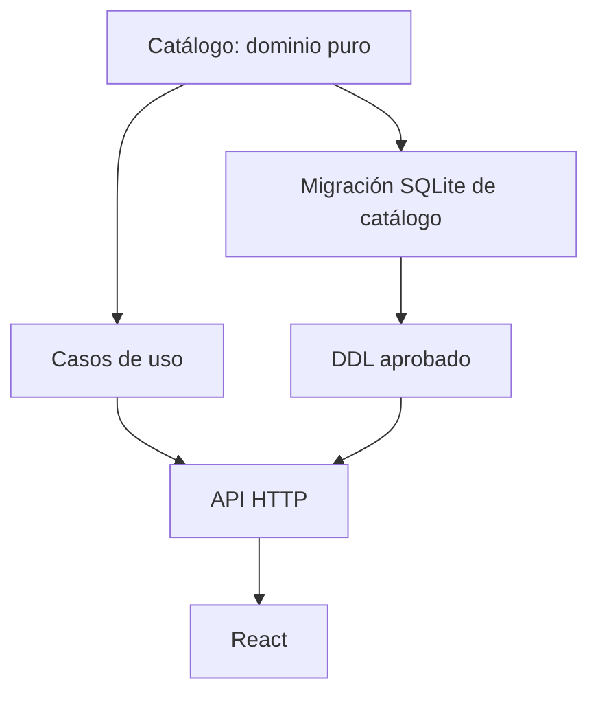
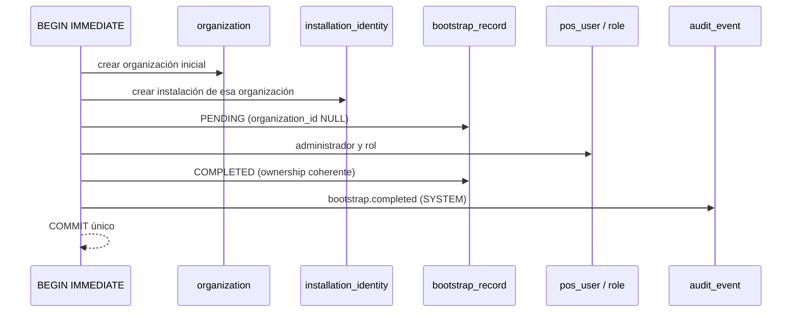

# Incremento 1J — Dominio de catálogo y arranque inicial verificado

**Estado: DOMINIO IMPLEMENTADO Y PROBADO. Sin DDL productivo de catálogo.**

Rama: `feat/backend/rust-catalog-domain-1j`, apilada sobre
`feat/backend/rust-increment-1i-prep` (`f41ad54e`). No se modificó `dev`, `main`,
`migrations/local/0001_organization_branch.sql` ni el Design Freeze.

## 1. Preflight

| Elemento | Estado observado |
| --- | --- |
| Worktree | Limpio; sin cambios ajenos |
| Rama base | `feat/backend/rust-increment-1i-prep` alineada con `origin` |
| HEAD base | `f41ad54e` (coincide con la referencia del encargo) |
| PR vigentes | #64, #65, #66 y #67 en Draft, apilados |
| `dev` / `main` | `329c0984` / `c290f518`, intactos |
| Toolchain | Rust estable del workspace; `Cargo.lock` respetado (`--locked`) |
| Linux/WSL2 + PostgreSQL 17 | No disponibles en este entorno; no se ejecutó el Migration Lab |

## 2. Alcance ejecutado y por qué

El paquete **D-AUTH-01..08, D-AUTH-10, D-AUTH-11, D-INST-01, D-INST-02** y
ADR-0022 sigue sin aceptación formal del titular. Ese bloqueo impide promover
`0002`–`0007` a `migrations/local`, no impide avanzar en trabajo independiente.

Este incremento ejecuta el **frente independiente A** del programa maestro:
reglas puras de catálogo, productos y modificadores, sin persistencia ni DDL.



El dominio ya está listo; las tres cajas restantes dependen de decisiones
físicas y de contrato HTTP todavía abiertas.

## 3. Componentes Rust añadidos

`pos-core::catalog` (nuevo módulo, sin dependencias de SQLx, Axum ni Tauri).

| Tipo | Responsabilidad | Regla principal |
| --- | --- | --- |
| `CatalogCode` | Código de categoría, grupo y opción | `java_trim` + minúsculas ASCII + `^[a-z0-9]+(-[a-z0-9]+)*$`, ≤64 UTF-16, inmutable |
| `Sku` | Identificador de negocio del producto | `java_trim` + mayúsculas + `^[A-Z0-9._-]{1,64}$`, inmutable |
| `Barcode` | Código de barras opcional | Conserva ceros iniciales; blanco → `None`; ≤64 UTF-16 |
| `Description` | Descripción opcional | Blanco → `None`; ≤1000 UTF-16 |
| `Decimal4` | Decimal exacto escala 4 | Sin coma flotante; ≤4 decimales; ≤15 dígitos enteros significativos |
| `UnitPrice` | Precio base | `Decimal4` no negativo |
| `PriceDelta` | Delta de modificador | `Decimal4` firmado (descuento, cero o recargo) |
| `PatchField<T>` | Semántica de patch | Distingue ausente, limpieza explícita y valor nuevo |
| `Category` | Categoría organizacional | Estado `ACTIVE`/`INACTIVE`, revisión optimista, sin borrado físico |
| `Product` | Producto con precio base | Categoría activa y de la misma organización; SKU inmutable |
| `ModifierGroup` | Grupo reutilizable | `max ≥ 1`, `min ≤ max`; semánticos derivados |
| `ModifierOption` | Opción del grupo | Organización derivada del grupo; delta firmado |
| `ModifierReplacement` | Plan de reasignación | Lista idéntica = no-op; identificadores repetidos = error |

Se añadieron además `category_changed_fields`, `product_changed_fields`,
`modifier_group_changed_fields` y `modifier_option_changed_fields`, que producen
los nombres de campo (`name`, `status`, `unitPrice`, `categoryId`, `selections`,
`priceDelta`, `displayOrder`) usados por la metadata de auditoría Java.

## 4. Paridad con el agregado Java

| Regla | Java (`catalog/domain/*`) | Rust (`pos-core::catalog`) |
| --- | --- | --- |
| Normalización de `code` | `trim().toLowerCase(Locale.ROOT)` en el servicio | `java_trim` + minúsculas ASCII |
| Gramática de `code` | `^[a-z0-9]+(-[a-z0-9]+)*$`, ≤64 | Idéntica |
| Normalización de `sku` | `trim().toUpperCase(Locale.ROOT)` | `java_trim` + mayúsculas Unicode |
| Gramática de `sku` | `^[A-Z0-9._-]{1,64}$` | Idéntica |
| `barcode` | `trim`, blanco → `null`, ≤64 | Idéntico, sin parsing GS1 |
| `description` | `trim`, blanco → `null`, ≤1000 | Idéntico |
| `unitPrice` | `signum() >= 0`, escala ≤4, entero ≤15 | `UnitPrice` (no negativo) + `Decimal4` |
| `priceDelta` | Firmado, escala ≤4, entero ≤15 | `PriceDelta` (firmado) + `Decimal4` |
| `minSelections` | `>= 0` | `u32` |
| `maxSelections` | `>= 1` | `u32` + validación `>= 1` |
| `min <= max` | Validado en el agregado | `validate_selections` |
| `required`/`single`/`multi` | Derivados, nunca almacenados | `is_required`, `is_single_choice`, `is_multiple_choice` |
| Revisión | `@Version` inicial `0` | `revision` inicial `0`, avance solo con cambio material |
| No-op | Sin mutación ni auditoría | El patch devuelve `false` y no incrementa la revisión |
| CATEGORÍA inactiva | `409 CATEGORY_INACTIVE` | `CatalogError::CategoryInactive` |
| Categoría de otra organización | `404` (sin filtrar existencia) | `CatalogError::OwnershipMismatch` |
| Reemplazo de modificadores | Duplicados `400`; lista idéntica no-op | `DuplicateModifierGroup` / `ModifierReplacement::Unchanged` |

### 4.1 Divergencias explícitas

| # | Diferencia | Motivo | Impacto |
| --- | --- | --- | --- |
| D1 | La notación científica (`1E3`) se rechaza | `Decimal4` solo admite forma decimal canónica | Java aceptaría `1E3`; los datos exportados desde PostgreSQL llegan como `1000.0000`, forma aceptada |
| D2 | `displayOrder` es `u32` | El valor negativo deja de ser representable | El transporte debe convertir con `catalog::display_order(i64)`, que devuelve error tipado |
| D3 | El rango lógico se guarda en `i128` | `NUMERIC(19,4)` excede el `INTEGER` de SQLite | `Decimal4::as_minor_i64` informa cuándo el valor no cabe; la representación física del catálogo Local sigue pendiente |
| D4 | Un `code` persistido con mayúsculas se rechaza al rehidratar | El contrato exige el valor canónico | Un adaptador no puede introducir un valor que el dominio no habría aceptado |

Ninguna de estas diferencias se aplicó silenciosamente: todas tienen prueba y
están registradas aquí. D3 requiere decisión física; D1, D2 y D4 son
endurecimientos de aceptación documentados.

## 5. Dependencia de arranque: organización → instalación → bootstrap

El encargo pedía descartar una dependencia circular en el primer arranque. La
revisión de `0002_installation_identity.proposed.sql` y
`0007_bootstrap_record.proposed.sql` confirma que **no existe ciclo**:

| Paso | Tabla | Requisito | Satisfacción |
| --- | --- | --- | --- |
| 1 | `organization` | Sin FK de instalación | Se crea dentro de la transacción de primer arranque |
| 2 | `installation_identity` | `organization_id NOT NULL → organization(id)` | La organización del paso 1 ya existe |
| 3 | `bootstrap_record` (`PENDING`) | `installation_id → installation_identity(id)`; `organization_id NULL` | La FK compuesta `(installation_id, organization_id)` no se evalúa con `NULL` |
| 4 | `pos_user`, `role` | FK compuesta same-org | Se crean en la misma transacción |
| 5 | `bootstrap_record` (`COMPLETED`) | Organización, administrador y rol no nulos y coherentes | La FK compuesta exige que instalación y organización se pertenezcan |
| 6 | `audit_event` | Actor `SYSTEM` sin `actor_user_id` ni `session_id` | El bootstrap se audita en el mismo commit |



La afirmación "la instalación puede ser PENDING antes de que exista la
organización" del comentario de `0007` es correcta solo para el **registro** de
bootstrap, no para la instalación: toda instalación tiene propietario desde su
inserción. La organización se crea primero, dentro de la misma transacción.

Evidencia (`pos-storage-sqlite/src/proposals_tests.rs`):

| Prueba | Qué demuestra |
| --- | --- |
| `first_run_requires_organization_before_installation_and_commits_once` | Insertar la instalación antes de la organización falla; el primer arranque completo (organización, instalación, `PENDING`, administrador, rol, `COMPLETED`, auditoría `SYSTEM`) se confirma en un solo commit y sobrevive a la reapertura |
| `first_run_rolls_back_everything_when_audit_fails` | Un actor `SYSTEM` con usuario atribuido viola el contrato; el rollback deja las tres tablas en cero |

Ambas pruebas parten de una base genuinamente vacía con `0001` y las propuestas
aplicadas. No son migraciones del producto ni se cargan desde `pos-local`.

## 6. Pruebas ejecutadas (Windows, SQLite real)

```bash
cd backend-rust
cargo fmt --all -- --check
cargo clippy --locked --workspace --all-targets --all-features -- -D warnings
cargo test --locked --workspace --all-features
cargo build --locked --workspace --all-features
```

| Crate / binario | Pruebas | Resultado |
| --- | --- | --- |
| `pos-core` | 50 (18 nuevas de catálogo) | OK |
| `pos-credentials` | 8 | OK |
| `pos-storage-sqlite` | 57 (2 nuevas de primer arranque) | OK |
| `pos-local` (lib, bin, integración) | 11 | OK |
| `migration-lab` | 27 | OK |
| **Total** | **143** | **0 fallos** |

Cobertura nueva del dominio:

- Códigos: normalización, límite de 64, rechazo de vacío, guiones extremos,
  guiones consecutivos, espacios, acentos y separadores no admitidos.
- SKU: mayúsculas, puntos/guiones/guiones bajos, rechazo de 65 caracteres y de
  `ß` → `SS` (paridad Unicode con Java antes de la gramática ASCII).
- Texto opcional: blanco → `None`, ceros iniciales conservados, límites exactos.
- Decimales: límites de escala y dígitos, cero negativo, `5.` y `.5` rechazados,
  ida y vuelta con `Display`, frontera `i64` de SQLite.
- Agregados: patch atómico, no-op sin incremento de revisión, versión obsoleta,
  desbordamiento de revisión, cambio de configuración, campos auditables.
- Modificadores: límites parciales, semánticos derivados, propiedad derivada del
  grupo, plan de reemplazo idempotente y rechazo de duplicados.

No se ejecutó `--require-complete`, el Migration Lab PostgreSQL 17 ni ningún gate
normativo; los resultados anteriores son exclusivamente SQLite/Windows.

## 7. Estado normativo y de gates

| Elemento | Estado |
| --- | --- |
| `0001_organization_branch.sql` | Publicada e intacta |
| `0002`–`0007` propuestas | Sin cambios en este incremento; siguen fuera de `migrations/local` |
| D-AUTH-01..08, D-AUTH-10, D-AUTH-11 | **Pendientes** de aceptación del titular |
| D-AUTH-09 (Argon2id comercial) | **Bloqueada** |
| D-INST-01, D-INST-02, ADR-0022 | **Pendientes** |
| DDL13 / PAR / AS | Sin promoción; `PAR-08` sigue siendo el único PASS histórico |
| CI de esta rama | No ejecutado en este entorno |
| Migración de catálogo a SQLite | No iniciada: depende de aprobación física |

## 8. Riesgos abiertos

1. El dominio de catálogo no tiene aún contrato físico Local. Un adaptador no
   puede implementarse hasta decidir la representación de importes (D3) y el
   esquema de `category`/`product`/`modifier_*`.
2. La unicidad de `code`/`sku`/`barcode` por organización y de `code` por grupo
   solo puede garantizarse físicamente con FKs compuestas e índices únicos; el
   dominio no puede sustituirlos.
3. La búsqueda `q` de Java usa `LIKE` insensible a mayúsculas sobre nombre, SKU y
   barcode. En SQLite ese comportamiento debe resolverse con `COLLATE NOCASE`
   (ASCII) o normalización explícita, igual que D-AUTH-11 para el email.
4. La autorización por permiso (`category.*`, `product.*`, `modifier.*`) existe en
   el catálogo de 59 códigos, pero no hay casos de uso que la apliquen todavía.

## 9. Próximo incremento recomendado

1. **Cerrar 1I** con la aceptación formal del paquete D-AUTH/D-INST o, en su
   defecto, mantener el bloqueo y avanzar el frente independiente **B** (cajas y
   turnos) y el **D** (máquina de estados de compras), ambos también de dominio
   puro.
2. Cuando exista aprobación física, promover `0002`–`0007`, añadir las tablas de
   catálogo y sustituir los adaptadores `*_lab` por adaptadores canónicos.
3. No declarar Auth/RBAC/auditoría productivos hasta contar con DDL aprobado,
   verificación criptográfica de producto, principal autenticado, autorización
   persistente y pruebas de integración completas.
